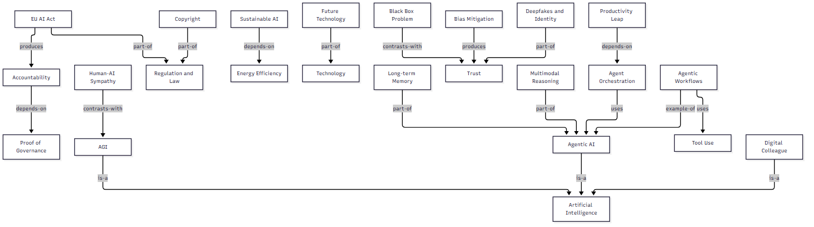
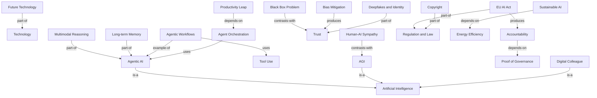

# Course Recap: Artificial Intelligence

## 1. Overview
This deck introduces Artificial Intelligence (AI) in 2026, described as the simulation of human intelligence by computer systems that has moved beyond simple automation into an "agentic" force able to reason, remember, and act autonomously (p.2). It frames AI within technology more broadly—the application of scientific knowledge for practical purposes, especially in industry—noting that the boundary between the "digital" and "physical" has almost entirely dissolved, so technology is no longer just a tool but an environment we inhabit (p.2). The deck then covers how AI works, the rise of agentic workflows, AI in the professional workplace, ethics and trust, regulation, and the future outlook toward AGI.

## 2. Main Topics

### AI and Technology Foundations
Definition: Artificial Intelligence (AI) is the simulation of human intelligence by computer systems; Technology is the application of scientific knowledge for practical purposes, especially in industry (p.2).
Key concepts:
- Artificial Intelligence: the simulation of human intelligence by computer systems (p.2)
- Agentic AI: AI that has moved beyond simple automation into an "agentic" force—systems that can reason, remember, and act autonomously to solve complex problems (p.2)
- Technology: the application of scientific knowledge for practical purposes, especially in industry (p.2)
- Future Technology: technology undergoing a structural shift from "experimentation" into "maturity" (p.3)
Important points:
- In 2026, AI has moved beyond simple automation to become an "agentic" force (p.2)
- The boundary between "digital" and "physical" has almost entirely dissolved (p.2)
- Technology is no longer just a tool we use, but an environment we inhabit (p.2)
- Emerging technologies are being woven into the durable foundations of global infrastructure (p.3)
Examples: none stated.

### How AI "Works" in 2026
Definition: How AI works in 2026 rests on multimodal reasoning, long-term memory, and tool use (p.4).
Key concepts:
- Multimodal Reasoning: processing text, voice, vision, and sensor data simultaneously (p.4)
- Long-term Memory: systems that remember user preferences and past interactions across different platforms (p.4)
- Tool Use: AI agents interact directly with software APIs (p.4)
Important points:
- AI agents can book travel, write code, or manage supply chains (p.4)
Examples: none stated.

### The Rise of Agentic Workflows
Definition: AI that doesn't just "chat" but follows a multi-step plan to achieve a goal (p.5).
Key concepts:
- Agentic Workflows: AI that follows a multi-step plan to achieve a goal (p.5)
- Agentic AI Adoption: a fourfold increase in sectors like manufacturing (p.5)
Important points:
- Impact: a fourfold increase in agentic AI adoption in sectors like manufacturing (p.5)
Examples: A marketing agent that researches a trend, creates content, schedules posts, and adjusts the budget based on real-time performance (p.5).

### AI in the Professional Workplace
Definition: In the professional workplace, AI is no longer a "tool" but a teammate (p.6).
Key concepts:
- Digital Colleague: AI acting as a teammate rather than a tool (p.6)
- Productivity Leap: small teams (3–5 people) can now execute global-scale projects by delegating data crunching and logistics to AI agents (p.6)
- Agent Orchestration: the ability to manage groups of AI agents, evolved from Prompt Engineering (p.6)
Important points:
- Small teams (3–5 people) can now execute global-scale projects (p.6)
- "Prompt Engineering" has evolved into "Agent Orchestration" (p.6)
Examples: none stated.

### Ethics, Bias, and Trust
Definition: The challenge of understanding why an AI made a specific decision, ensuring AI does not reinforce societal prejudices, and protecting identity (p.7).
Key concepts:
- Black Box Problem: the challenge of understanding why an AI made a specific decision (p.7)
- Bias Mitigation: active efforts to ensure AI doesn't reinforce societal prejudices in hiring or lending (p.7)
- Deepfakes & Identity: the shift in security from protecting data to protecting "agency" (p.7)
- Trust: the confidence that AI decisions are understandable, unbiased, and secure (p.7)
Important points:
- Security is shifting from protecting data to protecting "agency" (preventing hijacked AI agents) (p.7)
Examples: none stated.

### Regulation & The Law
Definition: Legal frameworks governing AI, including the EU AI Act and requirements for accountability (p.8).
Key concepts:
- EU AI Act: the world's first comprehensive framework, now in full effect, setting the global standard (p.8)
- Accountability: new laws require "Proof of Governance"—companies must show their AI is auditable and safe (p.8)
- Proof of Governance: the demonstration that AI is auditable and safe (p.8)
- Copyright: ongoing evolution of laws regarding AI-generated content and training data ownership (p.8)
Important points:
- The EU AI Act sets the global standard (p.8)
- Companies must show their AI is auditable and safe (p.8)
Examples: none stated.

### Future Outlook: Toward AGI?
Definition: Discussion of Artificial General Intelligence, sustainable AI, and human-AI sympathy (p.9).
Key concepts:
- AGI: Artificial General Intelligence—AI that equals human intelligence across all tasks (p.9)
- Energy Efficiency: the push for Sustainable AI as data center power demands continue to rise (p.9)
- Sustainable AI: AI driven by energy efficiency amid rising data center power demands (p.9)
- Human-AI Sympathy: a focus on technology that amplifies human creativity rather than replacing it (p.9)
Important points:
- Data center power demands continue to rise (p.9)
- The focus is on technology that amplifies human creativity rather than replacing it (p.9)
Examples: none stated.

### Conclusion & Summary
Definition: 2026 is the year AI moved beyond the screen and into the durable foundations of our infrastructure (p.10).
Key concepts:
- Main Takeaway: 2026 is the year AI moved beyond the screen and into the durable foundations of our infrastructure (p.10)
- Actionable Advice: invest in governance, prioritize human-AI collaboration, and stay adaptable (p.10)
Important points:
- Invest in governance (p.10)
- Prioritize human-AI collaboration (p.10)
- Stay adaptable (p.10)
Examples: none stated.

## 3. Key Takeaways
- 2026 is the year AI moved beyond the screen and into the durable foundations of our infrastructure (p.10).
- AI is now agentic: it reasons, remembers, and acts autonomously, using multimodal reasoning, long-term memory, and tool use (p.2, p.4).
- Agentic workflows follow multi-step plans, with a fourfold increase in agentic AI adoption in sectors like manufacturing (p.5).
- AI is a digital colleague, letting small teams (3–5 people) execute global-scale projects, and "Prompt Engineering" has evolved into "Agent Orchestration" (p.6).
- Trust depends on addressing the black box problem, bias mitigation, and deepfake/identity security (p.7).
- Regulation is maturing: the EU AI Act is in full effect, and accountability requires "Proof of Governance" (p.8).
- The future outlook centers on AGI, sustainable AI via energy efficiency, and human-AI sympathy (p.9).
- Actionable advice: invest in governance, prioritize human-AI collaboration, and stay adaptable (p.10).

## 4. Important Relationships
- Agentic AI --is-a--> Artificial Intelligence (p.2)
- Future Technology --part-of--> Technology (p.3)
- Tool Use --uses--> software APIs (p.4)
- Multimodal Reasoning --part-of--> How AI "Works" in 2026 (p.4)
- Long-term Memory --part-of--> How AI "Works" in 2026 (p.4)
- Agentic Workflows --uses--> Tool Use (p.4-p.5)
- Agentic Workflows --example-of--> Agentic AI (p.5)
- Agentic AI Adoption --depends-on--> Agentic Workflows (p.5)
- Agentic Workflows --depends-on--> Long-term Memory (p.4-p.5)
- Digital Colleague --is-a--> AI (p.6)
- Productivity Leap --depends-on--> Agent Orchestration (p.6)
- Agent Orchestration --uses--> AI agents (p.6)
- Bias Mitigation --produces--> Trust (p.7)
- Black Box Problem --contrasts-with--> Trust (p.7)
- Deepfakes & Identity --part-of--> Trust (p.7)
- EU AI Act --produces--> Accountability (p.8)
- Accountability --depends-on--> Proof of Governance (p.8)
- Copyright --part-of--> Regulation & The Law (p.8)
- Sustainable AI --depends-on--> Energy Efficiency (p.9)
- Human-AI Sympathy --contrasts-with--> AGI (p.9)
- Actionable Advice --depends-on--> Main Takeaway (p.10)
- Actionable Advice --uses--> governance (p.10)
- Actionable Advice --uses--> human-AI collaboration (p.10)

## 5. Concept Diagram

## 6. Review Report
Missing concepts: The reviewer found the summary complete (none missing). In the diagram, "Human-AI Sympathy" (p.9) and "Copyright" (p.8) were initially omitted.

Corrections applied:
1. Reversed the semantically backwards "Black Box Problem" relation in `concepts.md`, `summary.md` and `diagram.mmd`; it is now `Black Box Problem --contrasts-with--> Trust` (the black box problem is an obstacle to trust, expressed with the fixed verb vocabulary).
2. Added the node `Copyright[Copyright]` and connected it with `Copyright -->|part-of| Law`, adding a `Law[Regulation and Law]` node (also linked from `EU AI Act`).
3. Added the node `HumanSymp[Human-AI Sympathy]` connected with `HumanSymp -->|contrasts-with| AGI`.

Diagram verification: The updated `diagram.mmd` is a `graph TD` with 24 nodes (within the 10-25 range), all short labels derived from the concept sheet, edge labels using the fixed relationship verbs, no invented nodes, and no example topic names reused. It renders cleanly to PNG/SVG.

Final status: APPROVED WITH CORRECTIONS — corrections applied.
