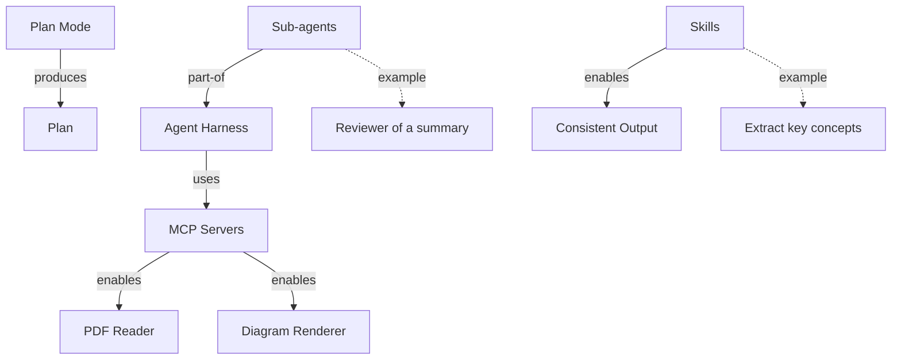

# Course Recap: AI Coding Agents (synthetic test deck)

## 1. Overview
A five-slide deck on the building blocks of an AI coding-agent workflow: the agent harness and the features around it (plan mode, MCP servers, sub-agents, skills).

## 2. Main Topics
### Agent Harness
- Definition: the tool that runs the model with files, shell and tools (p.1)
- Examples: Codex, OpenCode, Claude Code (p.1)

### Plan Mode
- Definition: the agent reads and proposes but does not edit files (p.2)
- Important points: output is a plan reviewed before code is written; reduces rework on larger tasks (p.2)

### MCP Servers
- Definition: MCP = Model Context Protocol; a server exposes tools the harness cannot do itself (p.3)
- Examples: PDF reader, diagram renderer; the harness calls them as tools by name (p.3)

### Sub-agents
- Definition: a named agent with its own role and instructions, in a separate context from the main agent (p.4)
- Example: a reviewer that checks a summary against the source; declared in harness config, not just a second prompt (p.4)

### Skills
- Definition: a reusable instruction folder (SKILL.md) loaded on demand (p.5)
- Important points: gives consistent output across inputs; example: extract key concepts in a fixed format (p.5)

## 3. Key Takeaways
- Plan first, then edit; MCP adds outside capabilities; sub-agents give an independent role; skills make output consistent.

## 4. Important Relationships
- Agent Harness uses MCP Servers; Sub-agents are part of the harness (declared in its config); Plan Mode produces a Plan; Skills enable consistent output.

## 5. Concept Diagram

## 6. Review Report
- Missing concepts: none
- Corrections applied: none
- Diagram verification: FAITHFUL
- Final status: APPROVED
